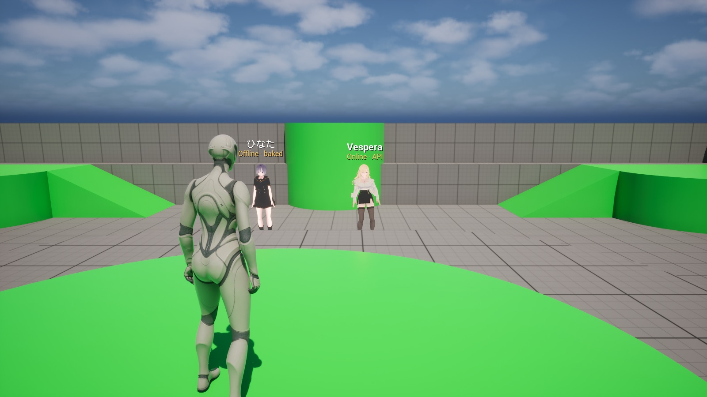
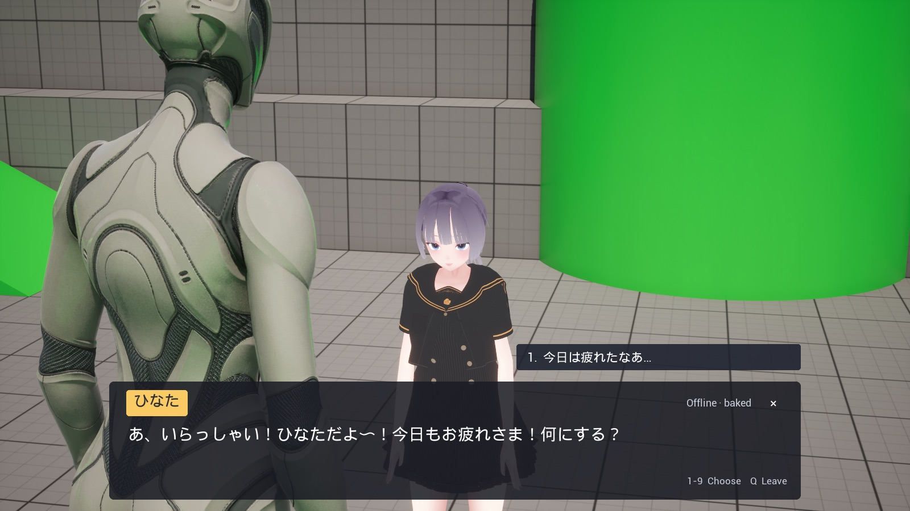
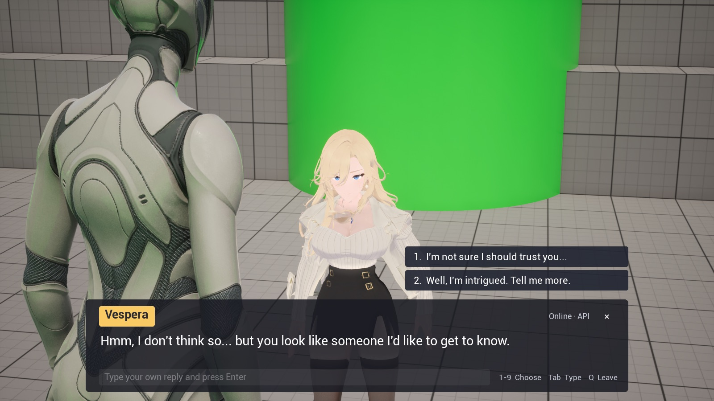

# Npcify Unreal example

A small third-person game made with Unreal Engine 5.8 (the *Third Person* C++
template). Two AI characters made with [Npcify](https://npcify.ai) stand in
the level:

| NPC | Mode | Where the replies come from |
| --- | --- | --- |
| **ひなた** | Offline, baked | A baked conversation that ships with the game (`.npcp` file). No network. |
| **Vespera** | Online | The Npcify API generates each reply, voice and lip-sync at run time. |

Walk to an NPC, press **E** and talk. The dialogue box works like a classic RPG:
typewriter text with voice and lip-sync, numbered reply choices, and (for the
online NPC) a free-text reply. The camera moves over the player's shoulder
during a conversation.



| Offline NPC | Online NPC |
| --- | --- |
|  |  |

## Requirements

- Unreal Engine **5.8** and a C++ toolchain for it (Xcode on macOS, Visual
  Studio 2022 on Windows). The project has C++ modules and plugins, so the
  editor compiles them when you open it.
- An internet connection for the online NPC.

## Start

1. Clone the repository.
2. Copy `.env.example` to `.env` and set `NPCIFY_API_KEY` to your Npcify API key.
   Create the key in the Npcify dashboard (**Settings > API keys**) and give it
   access to both characters. The offline NPC works without a key.
3. Open `NpcifyExample.uproject`. Let the editor build the modules when it asks.
   The level `/Game/ThirdPerson/Lvl_ThirdPerson` opens.
4. Press **Play**.

The `.env` file is in `.gitignore`. Do not commit your key.

The NPCs and the dialogue system are added when play starts
(`UNpcifyDemoSubsystem`), so you do not see them in the editor viewport. To place
NPCs yourself, drag `ANpcifyNpc` actors into a level; the subsystem then keeps
your actors.

## Controls

| Action | Keyboard and mouse |
| --- | --- |
| Move, look, jump | WASD, mouse, Space (a gamepad also works) |
| Talk to the nearby NPC | **E**, left click, or the left face button of a gamepad |
| Choose a reply | **1**–**9** or click |
| Skip the current line | Space |
| Type your own reply (online NPC) | Tab, then Enter |
| Leave the conversation | **Q**, Esc (packaged game) or **×** |

Esc stops Play In Editor, so use **Q** in the editor.

## How it works

| Part | File |
| --- | --- |
| Settings from `.env` | `Source/NpcifyExample/Npcify/NpcifyDemoEnv.cpp` |
| Spawns the NPCs and the director in front of the player start | `Source/NpcifyExample/Npcify/NpcifyDemoSubsystem.cpp` |
| NPC actor: VRM model, baked animations, Npcify Character component | `Source/NpcifyExample/Npcify/NpcifyNpc.cpp` |
| Interaction prompt, conversation flow, input, conversation camera | `Source/NpcifyExample/Npcify/NpcifyDialogueDirector.cpp` |
| RPG dialogue UI (UMG built in C++) | `Source/NpcifyExample/Npcify/NpcifyDialogueWidget.cpp` |
| Editor import of the characters | `Source/NpcifyExampleEditor/Private/NpcifyImportCharactersCommandlet.cpp` |

`UNpcifyCharacterComponent` from the Npcify Unreal SDK (`Plugins/NpcifySdk`,
version 0.2.0) does the character work: it plays each staging (speech audio,
lip-sync visemes, expressions, animation cues, typewriter text) and sets the
morph targets of the VRM model.

- **Offline NPC.** The game reads `Content/NpcifyData/hinata/conversation.npcp`
  (staged with the packaged game) and plays every reply from memory.
- **Online NPC.** `CreateConversation()` and `Speak()` request each reply from
  the API. The component downloads the speech audio before the line starts.

### Characters and animations

The VRM models are imported assets in `Content/Npcify/Characters/<name>/`
([VRM4U](https://github.com/ruyo/VRM4U) makes the skeletal mesh, the MToon
materials, the morph targets and the spring-bone post-process AnimBP). The
character's VRMA animations from Npcify are baked onto the character skeleton
(`Animations/AS_<animation ID>`), so the NPC plays the same idle, bow or
gesture animations that the Npcify web player uses.

## Use your own characters

1. Change the character IDs in `.env` (`NPCIFY_ONLINE_CHARACTER_ID`, and
   `NPCIFY_OFFLINE_CHARACTER_ID` for a character with **Enable baked
   conversation** turned on).
2. Download the characters (Python 3, no extra packages):

   ```bash
   python3 Scripts/fetch_characters.py
   ```

   The script writes `RawCharacters/` and the baked conversation in
   `Content/NpcifyData/`. It also converts each VRM to the form that VRM4U
   imports correctly: dense accessors, identity rest rotations (bind pose =
   rest pose), one skinned mesh, and materials in primitive order. The VRMA
   files get identity rest rotations too.
3. Close the editor and import:

   ```bash
   Scripts/import_characters.sh "/Users/Shared/Epic Games/UE_5.8"
   ```

   The commandlet `NpcifyImportCharacters` imports each model with VRM4U, sets
   the alpha cutoff of masked materials, and retargets each VRMA animation
   directly onto the character (FK chains only, as the Npcify web player does).
   The script deletes `Content/Npcify/Characters` first and makes all character
   assets again.
4. If you renamed the folders, change the entries in
   `Source/NpcifyExample/Npcify/NpcifyDemoSubsystem.cpp`.

## Packaged builds

A packaged game reads `.env` in its project folder: `<Game>/NpcifyExample/.env`
on Windows, `NpcifyExample.app/Contents/UE/NpcifyExample/.env` on macOS. Copy
your `.env` there after packaging. The NPC assets in `/Game/Npcify` are always
cooked (`Config/DefaultGame.ini`), because the NPCs load them by path. Do not
share a build that contains your key; give each player their own key or call
the API from your own server.

## Smoke test

The game has a scripted test that walks to each NPC, talks for two turns,
saves screenshots, writes `AUTOTEST PASSED` or `AUTOTEST FAILED` to the log
and quits:

```bash
"/Users/Shared/Epic Games/UE_5.8/Engine/Binaries/Mac/UnrealEditor.app/Contents/MacOS/UnrealEditor" \
  "$PWD/NpcifyExample.uproject" -game -windowed -ResX=1600 -ResY=900 -NpcifyAutotest=/tmp/npcify-shots -log
```

## Licenses

- The demo code (`Source`, `Scripts`) is MIT licensed, see [LICENSE](LICENSE).
- The level, the mannequin and the other template assets are Epic Games
  content under the Unreal Engine EULA.
- [VRM4U](https://github.com/ruyo/VRM4U) is MIT licensed; `Plugins/VRM4U/NPCIFY_NOTES.md`
  lists the local changes. VRM4U uses [assimp](https://github.com/ruyo/assimp)
  (BSD-3-Clause).
- The Npcify Unreal SDK includes [minimp3](https://github.com/lieff/minimp3) (CC0).
- The two characters (models, voices, conversation) belong to Npcify and are
  included for this demo only.
